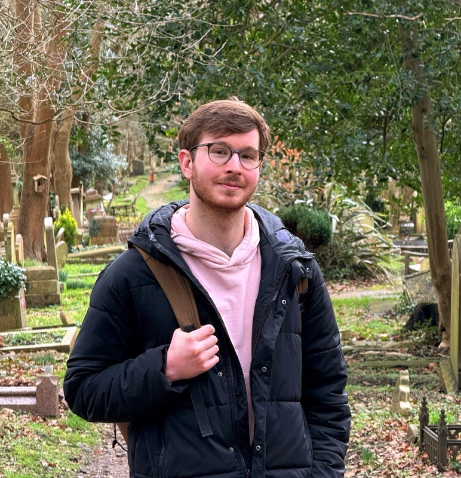

```{=html}
<div class="home-hero">
  
  <div class="hero-text">
    <p class="hero-name" role="heading" aria-level="1">Olaf Borghi, MSc</p>
    <p class="hero-subtitle">Postdoctoral Fellow | Centre for the Politics of Feelings</p>
    <ul class="hero-links">
      <li><a href="https://bsky.app/profile/olafborghi.com"><i class="bi bi-bluesky" aria-hidden="true"></i>Bluesky</a></li>
      <li><a href="https://github.com/olafborghi"><i class="bi bi-github" aria-hidden="true"></i>GitHub</a></li>
      <li><a href="https://www.linkedin.com/in/olaf-borghi-864276280/"><i class="bi bi-linkedin" aria-hidden="true"></i>LinkedIn</a></li>
      <li><a href="mailto:olaf.borghi@rhul.ac.uk"><i class="bi bi-envelope" aria-hidden="true"></i>Email</a></li>
      <li><a href="cv/"><i class="bi bi-file-earmark-person" aria-hidden="true"></i>CV</a></li>
    </ul>
  </div>
</div>
```

I am a Postdoctoral Fellow at the [Centre for the Politics of Feelings](https://www.politics-of-feelings.com) at the University of London. Before that, I was a doctoral candidate in the Marie-Curie network "[Interdisciplinary Perspectives of the Politics of Adolescence & Democracy](https://www.ippad.eu)" at Royal Holloway, University of London.

In my research, I investigate how political beliefs and attitudes develop, and the cognitive and emotional factors underlying this development. The developmental focus of my research works in two ways. First, I focus on adolescence and young adulthood, times of cognitive, emotional, and political change. Second, I study processes of belief development, examining how people change their minds based on new information, and different biases that affect political belief formation and updating. I also have a research focus on how young people feel about and imagine their future in times of multiple crises, and how this relates to their support for democracy and ideological views, including gender divides on political issues.

If you are interested in my work, would like to chat or collaborate, [contact me](mailto:olaf.borghi@rhul.ac.uk)!

## Recent news

:::{#news}
:::

```{=html}
<script>
document.addEventListener("DOMContentLoaded", () => {
  document.querySelectorAll(".news-carousel").forEach((carousel) => {
    const track = carousel.querySelector(".news-track");
    const prev = carousel.querySelector(".news-prev");
    const next = carousel.querySelector(".news-next");
    const step = () => {
      const card = track.querySelector(".news-card");
      return card ? card.getBoundingClientRect().width + 16 : track.clientWidth * 0.8;
    };
    const update = () => {
      const max = track.scrollWidth - track.clientWidth - 2;
      prev.disabled = track.scrollLeft <= 2;
      next.disabled = track.scrollLeft >= max;
      carousel.classList.toggle("is-scrollable", track.scrollWidth > track.clientWidth + 2);
      carousel.classList.toggle("at-end", track.scrollLeft >= max);
    };
    prev.addEventListener("click", () => track.scrollBy({ left: -step(), behavior: "smooth" }));
    next.addEventListener("click", () => track.scrollBy({ left: step(), behavior: "smooth" }));
    track.addEventListener("scroll", update, { passive: true });
    window.addEventListener("resize", update);
    update();
  });
});
</script>
```

## Methodological interests and open science

My work has a strong methodological and interdisciplinary focus. I combine quantitative methods and tools from across the social, developmental, and cognitive sciences, including cognitive tasks, survey experiments, text analysis, and cognitive modelling. I also place a strong emphasis on open science, and commit to openly sharing data and materials for all my papers.
